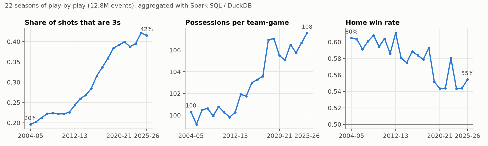
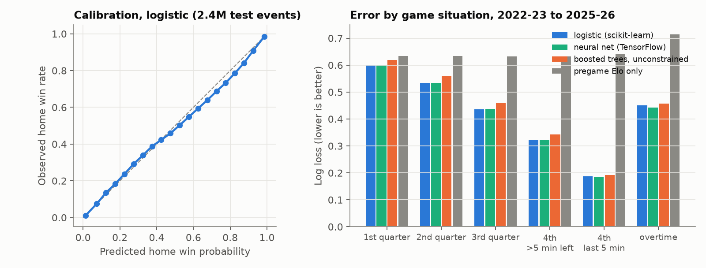
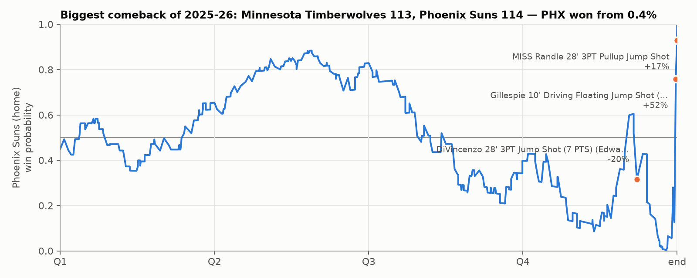
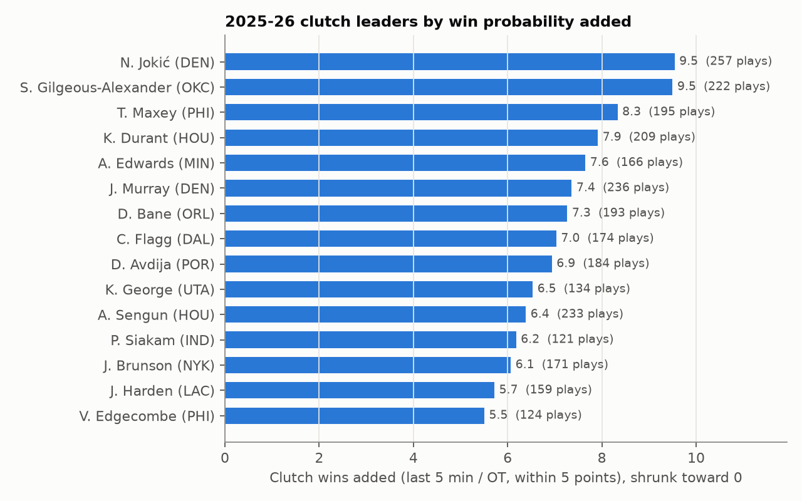
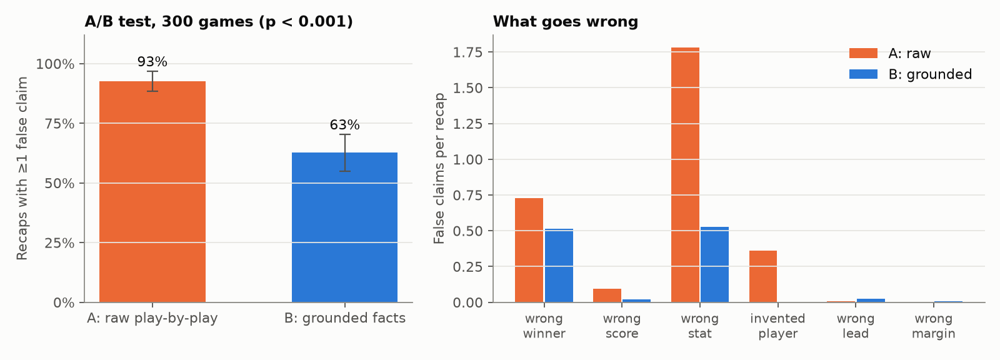

# NBA Game Intelligence

**22 seasons of NBA play-by-play (12.8 million events) turned into win probability, clutch
ratings and AI-written game recaps, plus a randomized experiment that measures how often
the AI gets the facts wrong.**

The whole data-science stack runs on real data, end to end:

| Layer | What it does | Tools |
|---|---|---|
| Lake | 22 seasons → Parquet → cleaned events, games, box scores | Python, **PySpark**, Spark SQL, pyarrow |
| Analytics | Era trends, team seasons, clutch leaderboards | **SQL** (DuckDB; same SQL runs on Athena), **pandas**, **numpy** |
| Modeling | In-game win probability, validated on held-out seasons | **scikit-learn**, **TensorFlow/Keras**, statistics (calibration, bootstrap, empirical Bayes) |
| GenAI + NLP | LLM recaps grounded in the lake; rule-based NLP fact checker | **PyTorch**, Hugging Face **transformers** (Qwen2.5-0.5B-Instruct, runs locally), regex/NLP |
| Experimentation | Pilot → power analysis → randomized **A/B test** of two prompt designs | scipy, statistics |
| BI | Tidy extracts and dashboard specs | **Tableau** |
| Cloud | Same Spark job as an AWS Glue job; S3 lake, Glue catalog, Athena | **AWS** (CloudFormation, deploy-ready) |

## Key results

| Question | Answer |
|---|---|
| Can raw play-by-play be trusted as-is? | **No.** Four silent bugs in the source would have corrupted everything downstream: every steal and block dropped, scores resetting to zero, fake leads at quarter breaks, no assists at all. Automated quality checks caught each one. After the fixes, box scores rebuilt from 12.8M plays match the official final in **99.4%** of 26,482 games. |
| How well can you predict the winner mid-game? | Log loss **0.455** on 2.4M events from the four most recent seasons (pregame Elo alone: 0.635), well calibrated (average calibration error 1.9 points). |
| Does a neural network beat logistic regression? | **No: they tie** (95% CI of the difference −0.0008 to +0.0006). Good features did the work. The TensorFlow net only helps in the last five minutes and overtime. Unconstrained boosted trees *memorize* games and do worst. |
| How has the game changed? | 3-point share of shots **20% → 42%**, pace **100 → 108** possessions, home win rate **60% → 55%** (2004-05 to 2025-26). |
| Who was clutchest in 2025-26? | Shai Gilgeous-Alexander (+10.1 wins added in clutch time), then Nikola Jokić and Tyrese Maxey: win probability added, shrunk with empirical Bayes. |
| Do LLM game recaps get the facts right? | **Mostly not.** With the raw play-by-play, **93%** of recaps contain a false claim: wrong winner, wrong stat lines, players who weren't in the game. |
| Does grounding the prompt in pipeline facts help? | **Yes: −30 points** (95% CI −39 to −21, p < 10⁻⁹) in a randomized test on 300 games. Claim accuracy rises from **44% to 90%** and invented players fall from 21% to 0. But 63% of grounded recaps still contain an error, mostly naming the wrong winner. |

## 1. The lake: PySpark over 12.8M raw events

`src/nbagi/ingest.py`, `src/nbagi/etl_spark.py`, `scripts/etl.py`

The raw play-by-play (public mirror of NBA Stats, [shufinskiy/nba_data](https://github.com/shufinskiy/nba_data))
is messy in ways that matter. The quality report caught each of these, and the ETL fixes it:

| Problem in the raw data | What it broke | Fix |
|---|---|---|
| `actionNumber` repeats for linked events (a turnover and its steal share one) | Deduplicating on it silently dropped **every steal and block** (660k rows) | Key on `actionId`, the true sequence |
| Before 2017-18, non-scoring rows store the score as 0-0; period markers carry junk numbers in every season | Forward-filled scores reset to 0 (950k "negative" scoring plays); fake "largest leads"; win probability jumped ±27% at quarter breaks | Take scores only from made shots and free throws, then forward-fill |
| Blocks and steals have a blank event type | Missing from box scores | Classify from the description text |
| Assists exist only as text: "(James 2 AST)" | No assist column at all | Parse the name; match it to a teammate in the same game. **98.9%** resolve to one player (ambiguous names are dropped, not guessed) |
| Possession is never recorded | Win probability needs to know who has the ball | Inferred from made shots, last free throws, rebounds and turnovers; known for 99.5% of events |
| `shotValue` doesn't exist before 2024-25 | Points per shot | Points come from score changes; 3s from "3PT" in the text |

Every season is processed as its own Spark job (bounded shuffle, the same shape as an
incremental daily job). After the fixes, team points rebuilt from individual plays match the
official final score in **99.4%** of games. The other 172 games contain scorer corrections
in the source, are flagged, and are excluded from anything a recap might state.



## 2. Win probability

`sql/wp_features.sql`, `src/nbagi/elo.py`, `src/nbagi/wp.py`, `scripts/train_wp.py`

Each event's state comes from SQL: score margin, time left, who has the ball, and a pregame
team-strength edge from an Elo rating rebuilt from 26,482 results. The models train on
2004–2019, are selected on 2020–21 and are scored once on **2022–23 to 2025-26 (2.4M
events)**. Confidence intervals resample whole games, because events within a game are not
independent.



| Test seasons, 2.4M events | Log loss | Brier | Calibration error |
|---|---|---|---|
| **Logistic regression** (selected on validation) | **0.455** | 0.152 | 0.019 |
| Neural network (TensorFlow/Keras, 3 layers) | 0.455 | 0.152 | 0.016 |
| Boosted trees, monotone constraints | 0.457 | 0.153 | 0.022 |
| Boosted trees, unconstrained | 0.476 | 0.158 | 0.030 |
| Pregame Elo only | 0.635 | 0.221 | 0.065 |

- **The neural net doesn't beat logistic regression overall** (difference CI −0.0008 to
  +0.0006). With features designed around how the game works (margin ÷ √time left, the
  pregame edge fading as time runs out, possession mattering more late), a linear model is
  enough. The network earns its keep only in the last five minutes and overtime.
- **Unconstrained boosted trees memorize games.** The pregame Elo gap is nearly unique to
  each game, so small leaves learn "this home team won": training log loss 0.41, test
  0.48. Monotone constraints (more lead or a better team can never lower win probability)
  and large leaves fix it.
- **Two bugs the charts caught.** An overtime flag (too few OT games to learn from) put
  tied overtimes at 30% for the home team. Modeling OT as "≤ 5 minutes left" fixed it:
  tied games entering OT now average 53% against an observed 58%. The possession term also
  had to vanish when the clock reads 0:00.



## 3. Clutch: win probability added, with shrinkage

`sql/wpa_events.sql`, `src/nbagi/wpa.py`

Every play's **win probability added** goes to the player who made it. As a check, the
WPA of every game sums exactly to the final result minus the opening win probability (max
error 6e-8). "Clutch" means the last five minutes or overtime with the score within five.
Rates are shrunk toward zero with an empirical-Bayes normal model, so a few lucky shots
can't top the board.



With a 40-play minimum, shrinkage is mild (median factor 0.94) and the top 10 doesn't
change. It matters for low-volume players further down the full table
(`artifacts/clutch_leaderboard.csv`).

## 4. AI game recaps, and how often they're wrong

`src/nbagi/recaps.py`, `src/nbagi/factcheck.py`, `scripts/recap_experiment.py`,
`scripts/analyze_experiment.py`

A small instruction-tuned LLM (Qwen2.5-0.5B, running locally on PyTorch/Apple GPU)
writes a 4-sentence recap of a 2025-26 game. Two prompt designs compete:

- **A, raw:** the final score and the last plays of the play-by-play log, the way a quick
  prototype would prompt a model.
- **B, grounded:** a fact sheet the pipeline builds: box-score leaders, each team's largest
  lead, and the three plays that swung win probability most.

**The fact checker** (`factcheck.py`) is rule-based NLP. It extracts every checkable claim
and verifies it against the box score:
- final scores;
- who won (team aliases plus win/loss verbs);
- player stat lines (name resolution handles "Jackson Jr." vs "G. Jackson", accents, and
  team names that are also surnames);
- invented players;
- leads and margins.

It was itself tested before use:

| Checker validation | Result |
|---|---|
| False alarms on 1,226 true-by-construction template recaps (11,034 claims) | **0** |
| Planted errors caught (one number changed per recap) | **93%** |
| Hand audit of 30 random flags on real model output | 28 correct; the 2 false-alarm patterns found were fixed |

### The experiment

The design was fixed in `config.yaml` before generation:
- **Pilot (paired).** 40 games, both prompts on every game.
- **Main test.** 300 *different* games, each randomized to one arm (150/150). The unit is the
  game.
- **Primary metric.** The share of recaps with at least one false checkable claim.

The pilot (87.5% vs 72.5% with errors) gave **90% power** at 150 games per arm.



| 300 randomized games | A: raw play-by-play | B: grounded facts |
|---|---|---|
| Recaps with ≥1 false claim (primary) | **92.7%** | **62.7%** |
| Difference, 95% CI | | −30.0 points (−38.8 to −21.2), z = 6.2 |
| Checkable claims per recap | 5.7 | 11.1 |
| Claim accuracy (game-bootstrap CI of the gap: +42 to +49 points) | 44% | 90% |
| Recaps naming a player who wasn't in the game | 21% | 0% |
| Final score correct, when the recap states one (87% / 95% do) | 90% | 98% |
| Sample-ratio check | 150 / 150 | p = 1.0 |

**What to change next.** The grounded fact sheet lists the away team first and never says
who won. The 0.5B model often assumes the first team named was the winner (0.51 wrong-winner
claims per recap). A one-line fix, "Winner: Oklahoma City Thunder", is the obvious next
arm. The harness makes it a config change and a 20-minute rerun.

**The measuring instrument changed during analysis.** The first version of the checker
split sentences after initials ("led by **J.** Brunson"), which hid many of the grounded
arm's wrong-winner claims. With that version the gap looked like −52 points (92% vs 40%).
After the hand audit and fixes (each now a unit test), it is −30 points. Both runs are in
`artifacts/` (`recap_experiment_checker_v1.json`), and the conclusion holds under either.

## Tableau

`make tableau` writes tidy extracts to `tableau/data/` (game win-probability curves, top
plays, clutch, team seasons, era trends, calibration, recap scores).
[`tableau/README.md`](tableau/README.md) specifies three dashboards (Game Flow, Clutch,
How the league changed), field by field.

## AWS

[`cloud/template.yaml`](cloud/template.yaml) (passes `cfn-lint`) provisions:
- an encrypted, versioned **S3** lake;
- the **same `etl_spark.py`** as an **AWS Glue 5.0** job;
- a Glue crawler that catalogs the curated tables once the job succeeds;
- an **Athena** workgroup with a 10 GB-per-query guardrail.

[`cloud/deploy.sh`](cloud/deploy.sh) deploys the stack, uploads the job and the raw lake, and
starts a run. It is **deploy-ready but not deployed**: running it creates billable
resources.

## Reproduce

```bash
python -m venv .venv && .venv/bin/pip install -e ".[dev]"
make all     # ingest (~2 min) → Spark ETL (~5 min) → models → clutch → recaps (~25 min) → analysis
make test    # unit tests: fact checker, Elo, features, metrics, shrinkage
make lint    # ruff + cfn-lint
```

Needs Java 17+ for Spark and about 4 GB of disk for the environment, data and model.

## Layout

```
config.yaml             every parameter (seasons, splits, clutch definition, experiment size)
sql/                    feature SQL, WPA SQL, era trends (DuckDB locally; Athena-compatible)
src/nbagi/
  ingest.py             download → Parquet lake, one season at a time
  etl_spark.py          PySpark ETL + quality report (local or AWS Glue)
  elo.py, features.py   pregame ratings, model features
  wp.py                 scikit-learn + TensorFlow win-probability models, metrics, bootstrap
  wpa.py                win probability added, empirical-Bayes clutch
  recaps.py             fact sheets, prompts, local LLM, template control
  factcheck.py          NLP claim extraction + verification
scripts/                one entry point per stage (see Makefile)
cloud/                  CloudFormation (S3, Glue, Athena) + deploy script
tableau/                extracts + dashboard specs
artifacts/              every number quoted above
```

## Limitations

- **Possession is inferred, not recorded.** Jump balls, and fouls away from the ball,
  leave it unknown for 0.5% of events.
- **Win probability ignores lineups and injuries.** The pregame edge is team-level Elo, so a
  star sitting out is invisible until it shows up in the score.
- **The fact checker under-counts errors.** It can only flag claims it can parse; stylistic
  claims ("dominated", "struggled") and runs ("a 14-2 run") go unchecked. Its recall on
  planted errors is reported above.
- **The LLM is deliberately small** (0.5B parameters, laptop-friendly). The experiment
  measures prompt design, not the best achievable model. The same harness can score a larger
  hosted model by swapping the `Generator`.
